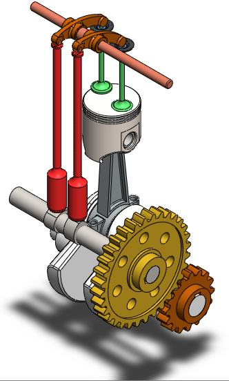

# Single-Cylinder Engine — SOLIDWORKS CAD Project

## Project Highlights

- 3D mechanical CAD modeling
- Multi-component mechanical assembly
- Assembly mates and component relationships
- Mechanical mechanism visualization
- SOLIDWORKS Motion Study
- Engine assembly animation
- Practical mechanical design experience

---

## Project Overview

This project is a 3D CAD modeling and mechanical assembly project of a single-cylinder engine developed using SOLIDWORKS.

The project was created as a practical exercise in mechanical design and CAD modeling, focusing on the development and assembly of individual mechanical components into a functional engine mechanism.

The final assembly includes a piston, connecting rod, crankshaft, camshaft, valves, rocker arms, gears, shafts, and other supporting components.

The project also includes a Motion Study and an animation demonstrating the interaction and movement of the main mechanical components.

---

## Main Components

The engine assembly includes:

- Piston
- Piston Pin
- Connecting Rod
- Crankshaft
- Camshaft
- Valves
- Valve Spring Retainer
- Rocker Arms
- Shafts
- Driving Gears
- Connecting Rod Cover
- Retainer
- Other supporting components

---

## Mechanical Assembly

The individual components were assembled in SOLIDWORKS to create the complete single-cylinder engine mechanism.

Mechanical mates and component relationships were used to position the components and define their interaction within the assembly.

The final assembly demonstrates the mechanical relationship between:

Crankshaft → Connecting Rod → Piston

and

Camshaft → Rocker Arms → Valves

with the gears providing the required mechanical relationship between rotating components.

---

## Motion Study

A Motion Study was created using SOLIDWORKS to visualize the movement of the engine mechanism.

The study focuses on the interaction between the:

- Crankshaft
- Connecting Rod
- Piston
- Camshaft
- Rocker Arms
- Valves
- Driving Gears

This provides a visual representation of the movement and interaction of the main components within the assembly.

---

## Animation

An animation of the final assembly was created using SOLIDWORKS Motion Study.

The animation demonstrates the movement of the main mechanical components and is included in the Animation folder.

### Animation File

Animation/Final Assembly.avi

---

## Project Gallery

### Final Assembly

Additional project images can be found in the Images folder.

---

## Software

- SOLIDWORKS 2025
- SOLIDWORKS Motion Study

---

## Technical Skills Demonstrated

This project helped develop practical experience in:

- 3D mechanical part modeling
- CAD design
- Mechanical assembly
- Assembly mates
- Component relationships
- Mechanical mechanisms
- Motion Study
- CAD visualization
- Mechanical design workflow

---

## Learning Outcomes

Through this project, I gained practical experience in mechanical CAD modeling, assembly design, and motion visualization.

The project strengthened my understanding of how individual mechanical components interact within an assembled mechanical system.

It also provided practical experience in using SOLIDWORKS to model mechanical components, create assemblies, establish component relationships, and visualize mechanical motion.

---

## Project Structure

`text
Single-Cylinder-Engine-Github/
│
├── Animation/
│   └── Final Assembly.avi
│
├── Images/
│   └── Final-Assembly.PNG
    ├── Cam-Shaft.PNG
    ├── Connecting-Rod.PNG
    ├── Connecting-Rod-0Cover.PNG
    ├── Crank-shaft.PNG
    ├── Driving-Gear-1.PNG
    ├── Driving-Gear-2.PNG
    ├── Piston-Pin.PNG
    ├── piston-Head.PNG
    ├── Retainer.PNG
    ├── Rocker-Arm.PNG
    ├── Rod.PNG
    ├── Shaft.PNG
    ├── Valve.PNG
    ├── Valve-Spring-Retainer.PNG
    │
    ├── Final-Assembly.PNG
    ├── Valve-Sub-Assembly.PNG
    
│
├── Cam Shaft.SLDPRT
├── Connecting Rod.SLDPRT
├── Connecting Rod Cover.SLDPRT
├── Crankshaft.SLDPRT
├── Driving gear 1.SLDPRT
├── Driving gear 2.SLDPRT
├── Piston Pin.SLDPRT
├── piston_head.SLDPRT
├── Retainer.SLDPRT
├── RockerArm.SLDPRT
├── Rod.SLDPRT
├── Shaft.SLDPRT
├── Valve.SLDPRT
├── Valve Spring Retainer.SLDPRT
│
├── Final Assembly.SLDASM
├── Valve Sub-Assembly.SLDASM
│
└── README.md